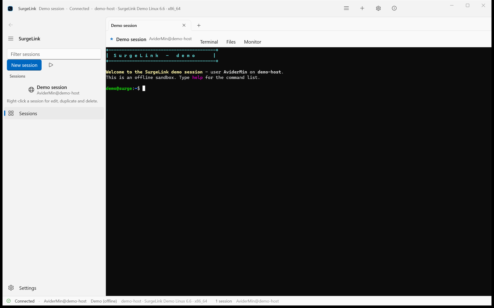
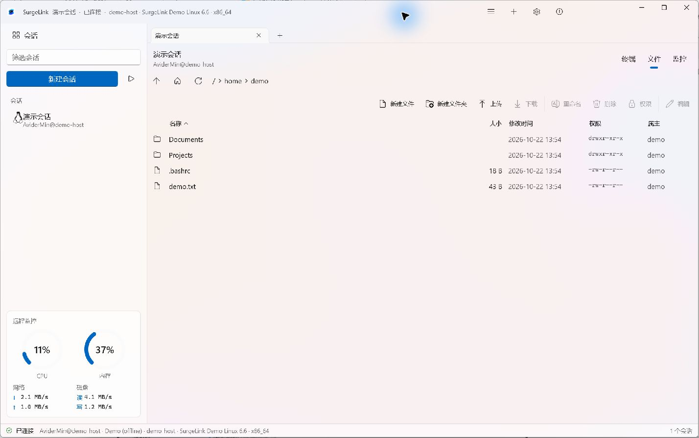
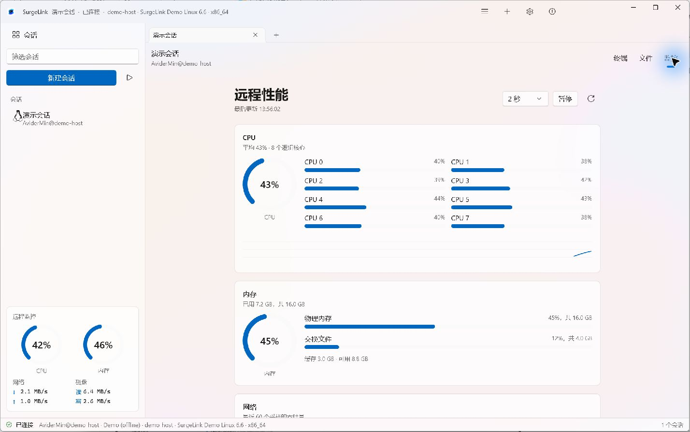
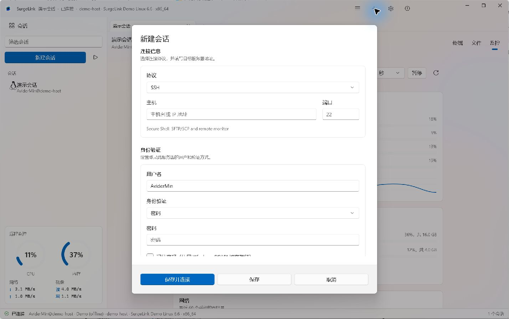

# SurgeLink

**把远程终端、文件管理和系统监控放进同一个 Windows 工作区。**

SurgeLink 是一款开源的 Windows 桌面 SSH／Telnet／串口客户端，使用 C#、WinUI 3 与 [Microsoft.UI.Reactor](https://github.com/microsoft/microsoft-ui-reactor) 构建，采用 MIT 许可证。当前版本：**1.0.3.11**。版本更新、构建与打包说明见 [README-FULL.md](README-FULL.md)。

## 这是什么？

如果你管理过远程服务器，大概经历过这样的日常：终端一个窗口、文件传输一个窗口、监控再开一个窗口。连接一多，桌面被窗口占满，切换时还要反复确认自己连的是哪台机器。

SurgeLink 想做的事很简单：**把这些事情放进同一个窗口。**

- 用标签页管理多个连接，SSH、Telnet 和串口都能在同一个工作区里打开。
- SSH 连接下可以在“终端”“文件”“监控”三个视图之间切换，点一下就能换。
- 没有服务器也能用内置的离线演示，先看看界面和操作方式。

一句话：少开几个工具，少切几次窗口，把注意力留给真正要做的事。

## 适合谁用

| 使用者 | 典型场景 |
| --- | --- |
| 运维工程师 | 登录 Linux 服务器巡检、查看日志、上传补丁文件 |
| 软件开发人员 | 在开发机、测试服务器之间切换，边看终端边改远程配置 |
| 嵌入式与网络设备调试人员 | 通过串口或 Telnet 连接开发板、路由器、交换机等设备 |
| 正在学习终端的人 | 用演示会话熟悉终端操作，不必先准备服务器 |

## 核心功能

### 连接：SSH、Telnet、串口，一个入口

| 连接类型 | 适合做什么 |
| --- | --- |
| SSH | 登录 Linux、Windows 等远程主机；支持密码、私钥和键盘交互认证，首次连接会请你确认主机指纹；可配置终端类型、命令输出编码、旧版算法与命令超时 |
| Telnet | 连接默认端口 23 的网络设备，在终端里交互登录；支持选项协商、终端类型与窗口尺寸同步；连接不加密，也不验证主机身份 |
| 串口 | 连接本地 COM 端口；可选择波特率、数据位、校验位、停止位和软／硬件流控，支持 DTR／RTS |
| 离线演示（Demo） | 不用真实服务器，直接体验终端、文件管理和监控界面 |

### 终端：日常操作该有的都有

- 自研 VT100／xterm 终端模拟器，支持 UTF-8，中文、日文、韩文宽字符也能正确对齐。
- 支持 16 色、256 色和真彩色，远程程序的颜色输出能正常显示。
- 滚动历史行数可配置；向上翻看日志或复制历史内容时，新输出不会把视图拉回底部。
- 支持文本选择、复制和粘贴。
- 支持在滚动历史和当前屏幕中查找文本（Ctrl+Shift+F）：匹配项高亮显示，可用 Enter／Shift+Enter 逐个跳转，Esc 关闭查找。
- 缩窄窗口时保留历史文本，恢复宽度后可重新显示；删除跨中文宽字符的文本时不会留下残缺的半格。
- 支持鼠标事件，按住 Shift 可以进行本地选择和滚动。

### 远程文件：不用再开一个传输工具

- 通过 SFTP 浏览远程目录，上传和下载文件。
- 服务器没有 SFTP 子系统时，会自动回退到 SSH 命令与 SCP。
- 新建文件与文件夹、重命名、删除、编辑文本、修改权限。
- 右键支持剪切、复制、粘贴以及查看属性。
- 支持远程文件的连接有独立的传输队列，显示进度并可取消；切换到终端或监控视图后队列仍然保留。

### 系统监控：服务器状态一眼看清

- 查看 CPU、内存、交换空间、磁盘、网络和进程。
- 支持 Linux 主机，也支持 Windows OpenSSH 主机。
- 具体能看到哪些指标，取决于服务器自身提供的能力。

### 会话管理：连接再多也不乱

- 会话支持分组、筛选，以及用多个标签页同时打开。
- 后台标签收到新输出时，标签页显示提示点；切回该标签后自动清除。
- 保存的连接可以编辑、复制和删除。
- 连接成功后自动识别远端系统，并显示 Windows、macOS、常见 Linux 发行版或 FreeBSD 图标。

### Agent 与 CLI（预览功能）

- 可以让支持 MCP（Model Context Protocol，一种让 AI 工具接入本地应用的通用协议）的 AI Agent（如 Codex、Claude Code、Cursor）或 `surgelink-cli` 连接 SurgeLink，读取或操作你授权的会话。
- 授权按会话单独进行：每个连接都需要你手动授权，可分别选择“允许读取”（终端与监控）、“允许文件”（只读文件）或“控制终端”；不授权时 Agent 看不到该会话。
- 你在终端里手动输入时，Agent 只会暂停（恢复后同一句柄可继续使用）；显式停止、关闭会话或重新连接才会撤销控制。
- 外部 Agent 可能把读取到的终端／文件内容发送给其模型服务商；SurgeLink 本身不连接 AI 服务商。
- 该功能仍在预览阶段，适合愿意尝鲜的用户。

### 界面：中文、英文，浅色、深色

- 简体中文、English、跟随系统三种界面语言。
- 浅色、深色主题，并适配 Windows 高对比度设置。
- 隐私模式可以遮挡会话列表、标签页、连接信息和提示中的服务器 IP／域名；鼠标悬停时查看原文，移开后重新遮挡。

### 离线演示：没有服务器也能体验

内置演示会话会模拟终端输出、内存文件系统和监控指标，不需要连接任何外部服务器。第一次使用前，可以先打开演示会话熟悉界面和操作方式。

## 界面预览

以下截图来自当前源码构建的中文界面，使用离线 Demo 会话；主机、文件和监控指标均为演示数据。

### 主窗口

左侧是会话列表；右侧上方是标签页，下方是终端内容；左下方显示当前连接的监控摘要。

### 远程文件管理

在同一个窗口里浏览远程目录、上传下载、编辑文本，并通过传输队列查看进度。

### 系统监控

CPU、内存、磁盘、网络和进程集中在一个页面，方便快速判断服务器状态。

### 新建会话

连接信息、身份验证和会话整理分组填写，底部保留“保存并连接”“保存”和“取消”。

## 快速上手

### 系统要求

- Windows 10 21H2（内部版本 19044）或更新版本。
- 支持 x64 和 ARM64 两种架构，请按设备选择对应的安装包。
- 安装包已内置 .NET 与 Windows App SDK 运行库，不需要单独安装 .NET SDK。

### 下载与安装

1. 打开 [GitHub Releases](https://github.com/AviderMin/SurgeLink/releases)。
2. 下载对应架构的 `SurgeLink-Setup-<版本>-<架构>.exe`。
3. 双击安装，按提示完成。安装程序提供开始菜单入口、可选桌面快捷方式和卸载。

> 提示：当前安装包尚未进行代码签名。

### 创建第一个连接

1. 点击“新建会话”，选择协议。SSH／Telnet 填写主机、端口和用户名（Telnet 用户名可留空）；串口选择 COM 端口并设置波特率等参数。
2. 选择认证方式：SSH 支持密码、私钥或键盘交互；名称和分组可选。
3. 点击“保存并连接”。SSH 首次连接需要核对远程主机指纹。
4. SSH 连接可在标签页内切换“终端”“文件”“监控”；Telnet 和串口只提供终端视图。

连接 SSH 主机时，第一次会看到主机指纹确认；如果指纹后来发生变化，应用会再次提示你确认。

### 没有服务器？打开演示会话

点击“打开演示会话”即可。不需要账号，也不需要网络，就能体验主要界面。

## 技术亮点（通俗解释）

| 亮点 | 对用户意味着什么 |
| --- | --- |
| 自研终端引擎 | 终端显示、颜色、滚动和复制粘贴由项目自己实现，不依赖第三方终端控件，中文宽字符和真彩色显示更可控 |
| 协议插件化 | SSH、Telnet、串口和演示各自是独立模块，界面不绑定某个具体协议，以后增加新协议不需要重写整个应用 |
| 本地存储与 DPAPI 保护 | 连接资料保存在本机；记住的密码和私钥口令由 Windows 当前用户加密保护，其他 Windows 账户无法直接读取 |
| 原子写入 | 保存设置或远程文件时先写临时文件，确认成功后再替换原文件（远程覆盖需服务器支持安全替换），降低写到一半出错导致文件损坏的风险 |
| 隐私模式 | 一键遮挡服务器 IP／域名，方便在会议、录屏或截图时保护信息 |

## 安全与隐私

SurgeLink 本身不包含广告、分析或自动上传服务；连接资料和日志保存在本机。

- 连接资料、设置、主机指纹和日志存放在 `%LOCALAPPDATA%\SurgeLink`（打包安装后 Windows 可能重定向此路径）。
- 记住的密码与私钥口令使用 Windows DPAPI（当前用户）加密保存；私钥文件仍保留在你选择的位置，应用不会复制它。
- Agent 功能默认关闭，每个连接都需要你手动授权；授权范围是同一 Windows 用户下的本地程序，当前不区分具体 Agent 应用。
- 使用外部 Agent 时，Agent 读取到的终端和文件内容可能被该 Agent 发送给其模型服务商；SurgeLink 本身不连接 AI 服务商。
- 日志和崩溃记录保存在本地，可能包含主机名、用户名、路径和错误详情，分享前请检查并脱敏；它们不会自动发送给开发者。
- 隐私模式只遮挡界面显示，不会替换终端输出和远程文件内容，也不会改变 Agent 读取到的数据。

### 使用前须知（当前限制）

- **RDP、VNC 尚未实现。** 当前版本只支持 SSH、Telnet、串口和离线演示。
- **Telnet 不加密，也不验证主机身份。** 不要在不可信网络上用它传输敏感信息。
- **真实服务器上的远程文件和系统监控需要 SSH 连接。** Telnet 与串口只提供终端；离线演示中的文件和监控为模拟数据。
- **ARM64 安装包需要真机验证。** 目前 ARM64 包是在 x64 环境交叉编译的，实际启动和功能仍需 ARM64 设备确认。
- **Windows 10 21H2 实机验证仍待完成。** 最低版本要求是 Windows 10 21H2（19044），但该版本的实机运行验证还在进行中。
- **Agent 功能仍是预览。** 授权后 SurgeLink 不会逐条审批命令或文件读取，执行策略由外部 Agent 应用负责；终端命令拥有远端账户的权限。
- 使用 MFA（多因素认证）的服务器上，文件视图会建立独立 SSH 连接，可能再次要求验证码。
- 安装包目前未进行代码签名。

## 项目现状与获取方式

- 当前源码版本：**1.0.3.11**。
- 许可证：[MIT](LICENSE)，可自由使用、修改和分发。
- 开发语言与框架：C#、WinUI 3、Microsoft.UI.Reactor。

| 入口 | 地址 |
| --- | --- |
| GitHub 仓库 | https://github.com/AviderMin/SurgeLink |
| 下载安装包 | https://github.com/AviderMin/SurgeLink/releases |
| 问题反馈 | https://github.com/AviderMin/SurgeLink/issues |

### 相关文档

- [README-FULL.md](README-FULL.md)：完整说明（版本更新、构建、打包与发布）。
- [docs/ARCHITECTURE.md](docs/ARCHITECTURE.md)：架构与线程模型（面向开发者）。
- [docs/AGENT-CLI.md](docs/AGENT-CLI.md)：Agent 与 CLI 接入契约（面向开发者）。
- [PRIVACY.md](PRIVACY.md)：隐私政策。
- [SECURITY.md](SECURITY.md)：安全说明与漏洞报告方式。

---

欢迎通过 [Issues](https://github.com/AviderMin/SurgeLink/issues) 提交问题或功能建议。报告问题时请附上版本、系统架构、复现步骤和经过脱敏的诊断信息。
