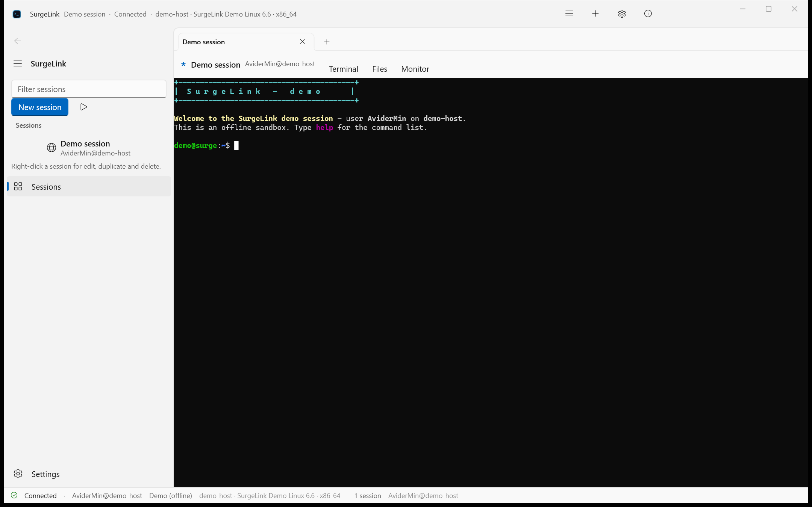
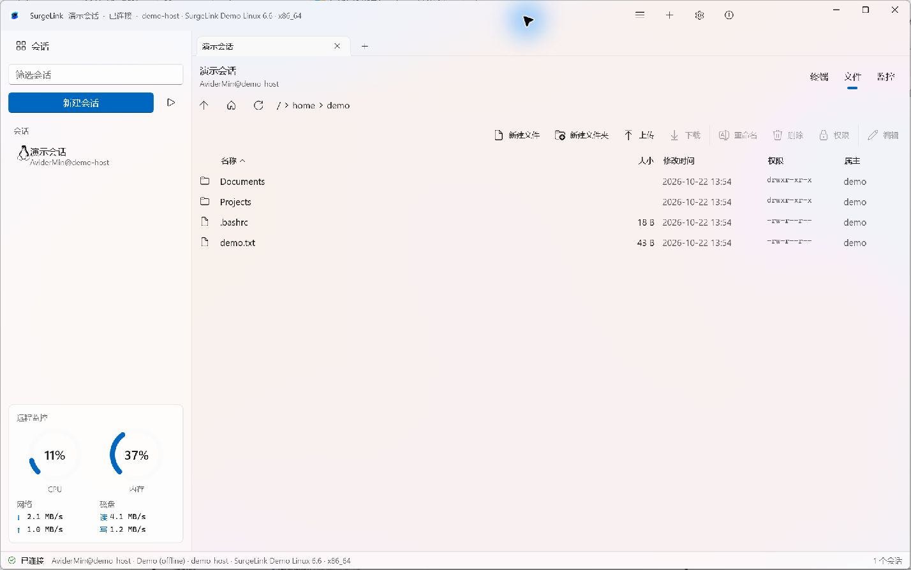
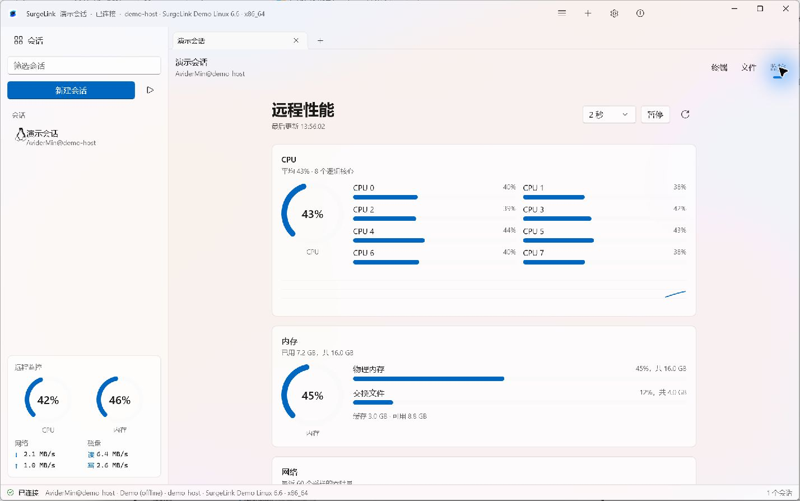
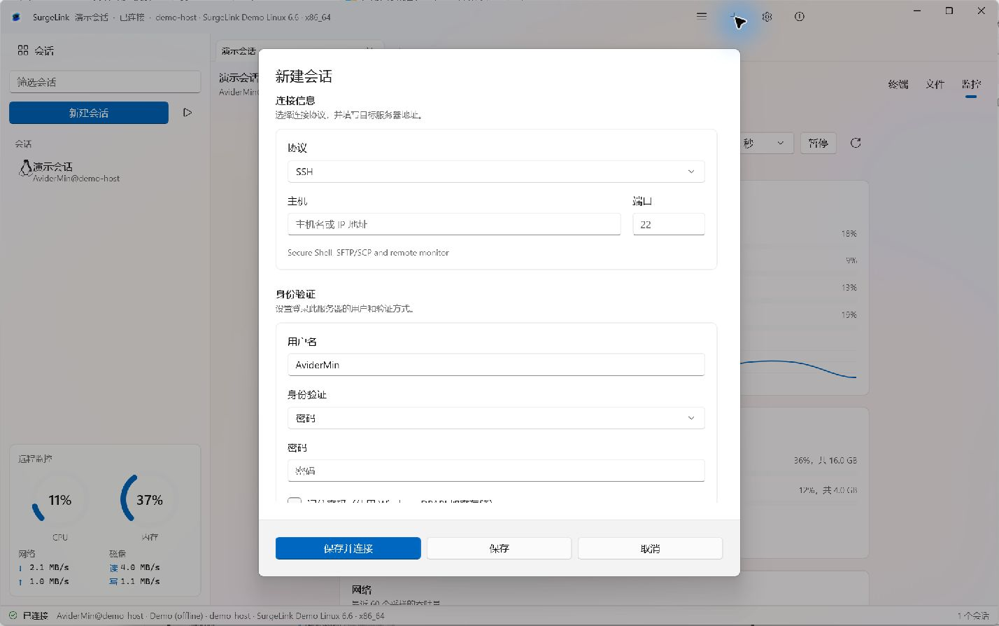

# SurgeLink


**把远程终端、文件管理和系统监控放进同一个 Windows 工作区。**

SurgeLink 是一款使用 C#、WinUI 3 和 [Microsoft.UI.Reactor](https://github.com/microsoft/microsoft-ui-reactor) 构建的开源 SSH／Telnet／串口客户端。通过标签页管理多个连接，在终端、远程文件和监控视图之间切换；无需服务器，也能用内置离线演示体验主要界面。

[功能](#功能) · [界面预览](#界面预览) · [开始使用](#开始使用) · [构建](#从源码构建) · [打包](#打包与-github-actions) · [文档](#开发文档)



## 功能

| 功能 | 当前支持 |
| --- | --- |
| SSH 连接 | 密码、私钥及键盘交互认证；首次连接确认主机指纹，密钥变化时重新确认 |
| Telnet 连接 | 默认端口 23，在终端内交互登录；支持选项协商、终端类型及窗口尺寸同步，连接不加密 |
| 串口连接 | 本地 COM 端口，支持设备枚举与刷新、波特率、数据位、校验位、停止位、软／硬件流控及 DTR／RTS |
| 终端 | 自研 VT100/xterm 模拟器，支持 UTF-8、中日韩宽字符、16／256／真彩色、滚动历史、文本选择与复制粘贴 |
| 远程文件 | SFTP 浏览与上传下载；服务器没有 SFTP 子系统时回退到 SSH 命令与 SCP |
| 文件操作 | 新建文件与文件夹、编辑文本、重命名、删除、权限编辑；右键剪切、复制、粘贴及查看属性 |
| 传输管理 | 会话内传输队列、进度与取消；切换到终端或监控视图后仍保留队列 |
| 系统监控 | CPU、内存、交换空间、磁盘、网络和进程；支持 Linux 与 Windows OpenSSH 主机，具体指标取决于服务器能力 |
| 会话管理 | 分组、筛选、多标签页，以及编辑、复制和删除保存的连接 |
| 系统图标 | 连接后识别系统并保存图标信息，内置 Windows、macOS、常见 Linux 发行版和 FreeBSD 图标 |
| 界面 | 简体中文／English／跟随系统，浅色、深色及高对比度主题 |
| 离线演示 | 模拟终端、内存文件系统和合成监控指标，无需连接外部服务器 |

当前实现的协议是 **SSH**、**Telnet**、**Serial** 和 **Demo**。Telnet 与 Serial 仅提供终端；远程文件和系统监控需要 SSH。RDP、VNC 等尚未实现。

## 界面预览

截图来自当前源码构建的中文界面，使用离线 Demo 会话；其中主机、文件和监控指标均为演示数据。

### 远程文件管理



剪切和复制支持多选，粘贴目标为当前远程目录。文件夹支持递归复制；同名目标会提示冲突，复制时不跟随符号链接。Ctrl+X、Ctrl+C、Ctrl+V 可在当前文件视图中使用。

上传和文本保存先写入同目录临时文件，成功后再提交；下载拒绝不安全的 Windows 文件名及覆盖已有本地文件。编辑器对实际读取内容限制为 4 MiB，关闭或重新加载前会提示未保存的更改。

覆盖已有远程文件需要服务器支持安全替换：SFTP 使用 OpenSSH POSIX rename 扩展；SCP 回退需要 `mv/ln -T`，新文件提交还需要同目录硬链接。不支持时操作失败并保留原目标，不降级为直接截断写入。

### 系统监控



### 新建会话



连接信息、身份验证和会话整理分别分组；表单内容可滚动，底部保留“保存并连接”“保存”和“取消”。

## 开始使用

### 系统要求

- Windows 10 21H2（内部版本 19044）或更新版本。
- 提供 **x64**、**ARM64** 两种安装包，请按设备架构选择。
- 分发包包含 .NET 与 Windows App SDK 运行库，无需安装 .NET SDK。

1.0.2.15 起主线的安装与应用最低版本统一为 19044；Windows 10 21H2 实机运行尚待验证，ARM64 也需对应设备验证。

### 获取安装包

从 [GitHub Releases](https://github.com/AviderMin/SurgeLink/releases) 下载对应架构的 `SurgeLink-Setup-<版本>-<架构>.exe`，双击安装。安装程序包含运行库，支持开始菜单入口、可选桌面快捷方式和卸载，目前未进行代码签名。

需要 APPX 侧载时，下载 `SurgeLink_<版本>_<架构>.zip`，按下述步骤安装。单独打包的测试产物也可从 [GitHub Actions](https://github.com/AviderMin/SurgeLink/actions) 下载，通常需要登录 GitHub，保留 14 天。

完整解压一次后，目录中包含：

```text
SurgeLink_<包版本>_<架构>.appx
SurgeLink-Development.cer
Install.ps1
```

在解压目录执行：

```powershell
powershell -NoProfile -File .\Install.ps1
```

这是开发证书签名的侧载包。安装脚本校验文件与证书，必要时通过 UAC 请求将配套公开证书加入 TrustedPeople，再安装 APPX。它不是 Microsoft Store 的安装流程。只检查文件而不安装可使用：

```powershell
powershell -NoProfile -File .\Install.ps1 -ValidateOnly
```

详细说明见 [打包与 Microsoft Store 提交](packaging/README.md)。

### 创建连接

1. 点击“新建会话”，选择协议，填写主机、端口和用户名。
2. 选择密码、私钥或键盘交互认证方式；名称与分组可选。
3. 点击“保存并连接”，核对远程主机指纹后继续。
4. 在标签页内切换“终端”“文件”“监控”。

第一次成功获取系统信息后，会话侧栏显示对应图标，并在重启后保留。尚未识别的系统使用通用图标；修改主机、端口或协议会清除旧的识别信息。

没有可连接的服务器时，点击“打开演示会话”即可体验。

连接 Telnet 时，在“新建会话”中选择 **Telnet**，填写主机，端口留空使用 23；用户名仅作会话标记，可留空。保存并连接后，在终端按服务器提示输入用户名和密码。Telnet 不加密，也不验证主机身份；应用不会自动发送保存的凭据。终端使用 UTF-8，支持 BINARY、ECHO、SUPPRESS-GO-AHEAD、TERMINAL-TYPE 和 NAWS 协商。

连接串口时，选择 **Serial**，从检测到的设备列表选择端口，或手动输入 `COM3` 这样的名称；插入 USB 串口适配器后可刷新列表。默认 **115200、8 数据位、无校验、1 停止位、无流控**，DTR／RTS 默认关闭；请按设备要求调整。参数随会话保存，编辑和复制会保留参数。串口不使用网络端口、用户名或保存的密码，登录信息在设备终端内输入。字节按原样收发，文本终端使用 UTF-8；改变窗口尺寸只影响本地显示，不向设备注入控制命令。

## 从源码构建

开发需要 Windows、**.NET 10 SDK** 和匹配的 Windows App SDK 开发依赖；普通开发构建还需要相应的 Windows App Runtime。依赖版本由 `Directory.Packages.props` 统一管理。

```powershell
git clone https://github.com/AviderMin/SurgeLink.git
cd SurgeLink

dotnet build SurgeLink.slnx -c Debug -p:Platform=x64
.\src\SurgeLink.App\bin\x64\Debug\net10.0-windows10.0.22621.0\win-x64\SurgeLink.exe
```

执行单元测试与协议契约测试：

```powershell
dotnet test SurgeLink.slnx -c Release -p:Platform=x64
```

测试覆盖终端解析、会话与存储、凭据保护、SSH 解析及协议能力契约。测试数量以实际运行结果为准。

## 打包与 GitHub Actions

本地生成包含运行库的安装包：

```powershell
pwsh -NoProfile -File tools/package-exe.ps1 -Version 1.0.2.15 -Architecture x64
pwsh -NoProfile -File tools/package-exe.ps1 -Version 1.0.2.15 -Architecture arm64
pwsh -NoProfile -File tools/package-appx.ps1 -Version 1.0.2.15 -Architecture x64
pwsh -NoProfile -File tools/package-appx.ps1 -Version 1.0.2.15 -Architecture arm64
```

| 产物 | x64 输出目录 | ARM64 输出目录 |
| --- | --- | --- |
| Inno EXE 安装包与 SHA256 | `artifacts/installer/x64/` | `artifacts/installer/arm64/` |
| APPX 分发 ZIP | `artifacts/appx/` | `artifacts/appx/arm64/` |

[Release 工作流](.github/workflows/release.yml) 支持手动运行或推送 `v1.0.2.15` 形式的数字版本标签。它复用 [Installer](.github/workflows/package-exe.yml) 和 [APPX](.github/workflows/package-appx.yml) 工作流，先运行测试，再分别构建两个架构。完整产物上传草稿后，核对或创建指向构建提交的 Tag，再公开 Release，提供 EXE、APPX ZIP 与 SHA256 校验清单。单独运行打包工作流只上传 Actions 产物，保留 14 天，不创建 Release。工作流不自动提交 Microsoft Store。

打包使用临时生成的开发签名密钥，完成后删除临时 PFX；不需要向仓库提交私钥或配置签名 Secrets。ARM64 包在 x64 runner 上交叉编译，实际启动与功能仍需在 ARM64 设备验证。

## 数据与隐私

连接资料、设置、主机指纹和日志存放于 `%LOCALAPPDATA%\SurgeLink`；打包安装后 Windows 可能重定向此路径。

- 记住的密码和私钥口令通过当前 Windows 用户的 DPAPI 加密保存。
- 会话资料保存主机、用户名和私钥路径；私钥文件仍保留在用户选择的位置。
- 日志和崩溃记录保存在本地，可能包含主机名、用户名、路径及错误详情；分享前请检查并脱敏。
- 应用未内置广告、分析或自动诊断上传服务。
- 设置中的“隐私模式”可遮蔽会话列表、标签、连接信息和提示中的服务器 IP／域名；鼠标悬停时查看原文，移开后重新遮蔽。设置会保存，终端输出和远程文件内容不做替换。

完整说明见 [隐私政策](PRIVACY.md) 和 [安全说明](SECURITY.md)。

## 项目结构

```text
src/
  SurgeLink.App/                   WinUI 3 + Reactor 界面与应用服务
  SurgeLink.Core/                  会话、存储、安全及协议能力接口
  SurgeLink.Terminal/              VT/xterm 终端模拟引擎
  SurgeLink.Protocols.Ssh/         SSH、SFTP、SCP 与系统监控
  SurgeLink.Protocols.Telnet/      Telnet 终端与协议协商
  SurgeLink.Protocols.Serial/      本地串口终端与连接参数
  SurgeLink.Protocols.Demo/        离线演示协议
tests/                            单元测试与协议契约测试
tools/                            构建、打包和开发辅助脚本
packaging/                        APPX 清单与安装模板
docs/                             架构、开发指南与界面截图
.github/workflows/                GitHub Actions 工作流
```

UI 使用 C# 元素树与 Reactor hooks 描述，底层仍是原生 WinUI 控件。协议通过能力接口向界面提供终端、文件和监控功能，新增协议不必重写应用外壳。

## 开发文档

- [外部 AI Agent / MCP 接入开发方案](docs/AI-AGENT-MCP-DEVELOPMENT.md)（设计提案）
- [架构与线程模型](docs/ARCHITECTURE.md)
- [新增协议与契约测试](docs/ADDING-A-PROTOCOL.md)
- [WinUI 3／Reactor 界面规范](docs/UI-GUIDELINES.md)
- [开发验证说明](docs/VERIFICATION.md)
- [打包与商店提交](packaging/README.md)

欢迎通过 [Issues](https://github.com/AviderMin/SurgeLink/issues) 提交问题或功能建议。报告问题时请附上版本、系统架构、复现步骤和经过脱敏的诊断信息。

## 许可证

项目采用 [MIT License](LICENSE)。内置系统图标的来源、署名与独立许可见 [图标声明](src/SurgeLink.App/Assets/SystemIcons/NOTICE.md)，其他依赖遵循各自的许可条款。
