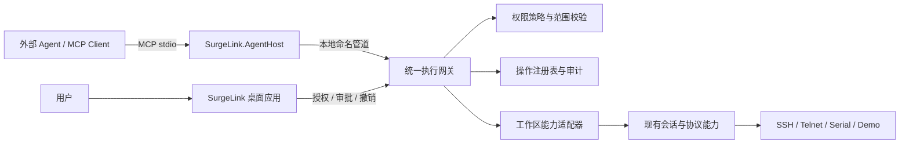
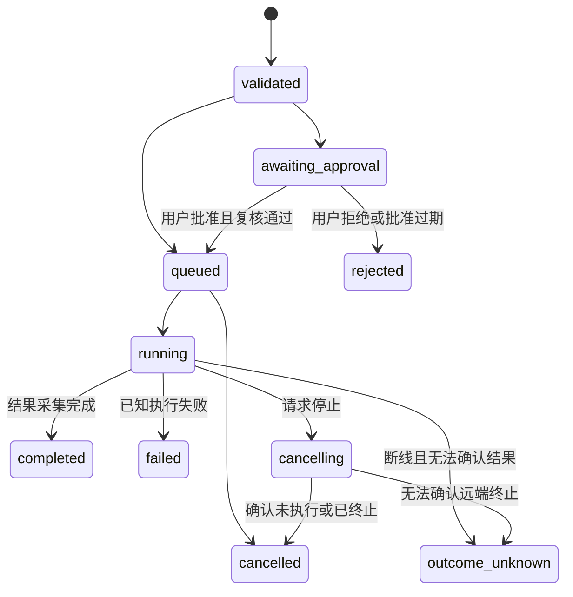

# SurgeLink 外部 AI Agent / MCP 接入开发方案

文档状态：设计提案，尚未实现。编写日期：2026-10-24。

基线：当前 SurgeLink 源码，参考提交 `42eaff93a898abbfe2be8dbf36157cc78502ffc0`，以及本地生成的 1.0.2.22 安装包。安装包版本由打包参数覆盖；当前 `Directory.Build.props` 默认版本仍为 1.0.2.21。本文中的新项目、新接口、工具名和配置均为拟议设计，不表示现有版本已经支持 MCP。

本文的目标是：**让外部 AI Agent 通过 MCP，使用用户在 SurgeLink 中授权的远程会话，完成观察、诊断、命令执行和文件操作。** 模型推理与任务规划由外部 Agent 负责，SurgeLink 负责连接、操作执行、权限控制、用户交互和可核验的执行记录。

首期不内置模型聊天服务，不管理模型 API Key，不要求部署云端中转，也不要求远端主机安装 Agent。后续可扩展，但不作为本方案的前置条件。

## 目录

1. [主体思想与产品目标](#1-主体思想与产品目标)
2. [当前项目基础与能力缺口](#2-当前项目基础与能力缺口)
3. [总体组织架构](#3-总体组织架构)
4. [模块、工程目录与依赖](#4-模块工程目录与依赖)
5. [接入、配对与会话授权](#5-接入配对与会话授权)
6. [MCP 工具与数据契约](#6-mcp-工具与数据契约)
7. [命令、终端与文件的实现](#7-命令终端与文件的实现)
8. [权限、安全与隐私边界](#8-权限安全与隐私边界)
9. [任务生命周期与健壮性](#9-任务生命周期与健壮性)
10. [桌面交互与界面规范](#10-桌面交互与界面规范)
11. [现有代码的改造清单](#11-现有代码的改造清单)
12. [实施阶段与工作组织](#12-实施阶段与工作组织)
13. [测试、验收与发布](#13-测试验收与发布)
14. [端到端示例](#14-端到端示例)
15. [决策记录与后续扩展](#15-决策记录与后续扩展)
16. [依据与参考资料](#16-依据与参考资料)

## 1. 主体思想与产品目标

### 1.1 产品定位

SurgeLink 成为外部 Agent 的远程操作工作台。外部 Agent 提出结构化操作请求，SurgeLink 根据当前连接、用户授权和执行条件决定能否执行，并返回真实结果。用户可以在同一个 Windows 工作区查看 Agent 正在访问哪台主机、执行什么操作、修改哪些文件，并随时撤销授权。

核心闭环为：

```text
用户提出目标 → Agent 获取授权范围内的事实 → Agent 提议操作
→ SurgeLink 校验、按策略请求批准 → 执行并记录 → 返回证据 → Agent 验证结果
```

### 1.2 六项设计原则

| 原则 | 开发含义 |
| --- | --- |
| 连接能力复用 | 使用现有协议插件、会话管理、主机密钥验证、文件和监控能力；不在 MCP 层重新实现 SSH |
| 外部规划，本地裁决 | Agent 负责规划；授权判断和执行事实始终由 SurgeLink 产生 |
| 会话范围明确 | 每个请求绑定授权句柄和连接代次，不通过当前活动标签猜测目标 |
| 结构化工具优先 | 读取文件、查询指标、执行独立命令各有工具与结果模型 |
| 操作可见、可停止 | 请求、审批、执行、失败和结果不确定均进入操作面板 |
| 默认最小暴露 | MCP 默认关闭；启用后也只公开用户选择的连接和能力 |

“全面支持”应理解为统一、可扩展的能力入口：兼容具备相应 MCP 能力的外部 Agent，并逐步覆盖 SurgeLink 的主要能力。不同协议保留真实限制，不为 Telnet 或串口伪造 SSH 的文件系统和命令退出码。

### 1.3 首个可交付版本的用户体验

1. 用户打开 SurgeLink，连接一个 SSH 会话，启用“外部 Agent 接入”。
2. 用户将生成的 MCP 启动配置加入支持 MCP stdio 的客户端。
3. 外部客户端启动桥接程序，SurgeLink 提示配对，并让用户选择可访问会话。
4. Agent 能列出已授权会话，读取明确授权的终端片段、目录、文本文件和监控信息。
5. Agent 提交命令或文件修改时，用户看到准确目标与具体内容；批准后执行。
6. 执行结果有退出码、输出、截断说明或明确的失败状态；用户能一键断开 Agent。

首期以 SSH 和 Demo 为主要落地对象。Telnet、Serial 先支持受限的屏幕读取与用户确认后的交互输入，自动化设备操作后置。

## 2. 当前项目基础与能力缺口

### 2.1 已有基础及对应扩展点

| 当前代码 | 当前职责 | MCP 接入时的作用 |
| --- | --- | --- |
| `SurgeLink.Core/Protocols/IProtocolPlugin.cs`、`ProtocolCatalog` | 协议注册和连接入口 | 保持协议隔离；MCP 不直接引用 SSH.NET |
| `SurgeLink.Core/Sessions/IProtocolSession.cs` | 活连接及 Terminal / FileSystem / Monitor 可选能力 | 绑定已授权的运行中会话；新增独立命令能力 |
| `SurgeLink.Core/Sessions/SessionManager.cs` | 解析连接凭据、建立和关闭连接 | 沿用凭据和主机密钥流程；首期不向 Agent 开放创建任意连接 |
| `SurgeLink.App/Sessions/WorkspaceStore.cs` | 标签、工作区快照、连接关闭 | 从桌面侧提供会话快照与生命周期事件 |
| `SurgeLink.App/Sessions/TerminalBridge.cs` | 远端字节与终端模拟器之间的桥接 | 输出观察、屏幕快照、交互输入仲裁 |
| `SurgeLink.Terminal/ITerminalEmulator.cs` | 屏幕、滚动历史、选择文字、可见文本 | 在短锁内复制上下文；保持终端引擎不依赖 MCP |
| `SurgeLink.Core/Files/IRemoteFileSystem.cs` | 文件列举、读取、写入、重命名等 | 提供受限文件工具；复用协议能力 |
| `RemoteFileWrite`、`BoundedTextFile` | 暂存后提交、实际读取字节上限、文本编码 | 文件修改与读取的基础，仍需补充 Agent 范围校验 |
| `FileTransferQueue` | 会话内传输、进度和取消 | 后续传输工具接入同一队列和任务面板 |
| `IRemoteSystemMonitor` | 系统指标与进程采样 | 提供结构化诊断信息，控制采样频率 |
| `InteractionService`、`ModalQueue` | 排队显示原生交互 | 复用主机指纹、认证等必要交互；Agent 审批主要进入非模态面板 |
| `DpapiSecretProtector`、`EncryptedCredentialStore` | 当前 Windows 用户的凭据保护 | 连接认证留在应用内部，不产生读取密码的 MCP 工具 |
| `AppServices.Create` | 服务组合根 | 装配网关、权限、操作注册表、审计和本地 IPC |

路径均相对于仓库的 `src/`。当前源码没有 MCP Server、Agent 授权服务或公共命令执行接口。

### 2.2 必须补齐的能力

- **独立命令通道**：`SshCommandRunner` 已用于内部查询，能够返回 stdout、stderr、退出码，但它位于 SSH 实现内部，尚未通过 Core 对外提供能力；输出收集也没有满足 Agent 场景的流量上限。
- **可等待的交互输入**：`TerminalBridge.SendText/SendPaste/SendKey` 是 UI 便利入口，内部发送会捕获错误；不能据此向 Agent 宣称输入已成功执行。
- **稳定的授权会话模型**：保存配置 ID、工作区标签 ID、运行中 `SessionId` 应有明确映射，重连后旧授权不能指向新连接。
- **受控上下文**：当前可见文本不等于完整输出记录；滚动历史也不是命令完成协议。
- **跨入口操作调度**：Agent、用户终端输入、文件编辑器和监控必须协调资源与生命周期。
- **外部入口安全**：当前隐私模式属于 UI 遮蔽，不是 API 数据过滤或 Agent 授权机制。

### 2.3 协议支持矩阵

| 对外能力 | SSH | Telnet | Serial | Demo |
| --- | --- | --- | --- | --- |
| 已授权屏幕快照 | 支持 | 支持 | 支持 | 支持 |
| 交互式输入 | 有条件开放 | 有条件开放 | 有条件开放，默认禁用自动输入 | 支持演示 |
| 独立命令、退出码 | 新增 Exec 能力后支持 | 不承诺 | 不承诺 | 通过模拟实现验证契约 |
| 文件工具 | 沿用 SFTP / SCP 的实际能力 | 不支持 | 不支持 | 内存文件系统 |
| 监控工具 | 沿用 Linux / Windows 探针 | 不支持 | 不支持 | 合成指标 |

SSH 也需区分远端能力：部分设备拒绝 exec 通道或只提供受限命令。工具必须返回 `capability_unavailable`，不自动向交互终端注入同一命令作为回退。

## 3. 总体组织架构

### 3.1 推荐拓扑：stdio 伴随进程 + 桌面执行网关

首期采用一个独立控制台程序 `SurgeLink.AgentHost.exe` 作为 MCP stdio Server。外部 Agent 客户端启动该进程；伴随进程通过仅面向当前用户的本地命名管道连接已运行的 SurgeLink 桌面应用。会话与凭据继续由桌面进程持有。



stdio 和 Streamable HTTP 都是 MCP 标准传输；stdio 使用客户端启动的子进程，适合首期本地桌面接入。具体协议封装交由 SDK 实现。[MCP 传输规范](https://modelcontextprotocol.io/specification/2026-07-28/basic/transports)

### 3.2 为什么这样划分

- WinUI 应用继续采用现有窗口与生命周期，不承担读写 MCP 标准输入输出的职责。
- AgentHost 只转换协议与数据；审批、授权和实际执行仍在持有连接的桌面进程内完成。
- 新的外部客户端可以复用同一套工具与规则，避免各自实现 SSH 连接和凭据读取。
- 不开放本机 TCP 监听端口，也无需把桌面工作区暴露到局域网。
- 桌面应用退出或 MCP 接入被关闭后，伴随进程不能继续使用连接。

伴随进程降低协议故障对桌面 UI 的影响，但普通同用户进程之间不构成强安全沙箱。已完全控制当前 Windows 用户账户的恶意程序不在此架构可隔离的范围内。

### 3.3 职责边界

| 组件 | 负责 | 不持有 |
| --- | --- | --- |
| 外部 Agent / MCP Client | 模型、规划、对话、工具调用与结果解释 | SurgeLink 内部凭据、未授权会话 |
| AgentHost | SDK 托管、工具协议映射、输入尺寸限制、本地 IPC | SSH Client、私钥口令、完整工作区对象 |
| 桌面执行网关 | 身份绑定、授权、参数校验、排队、审批、执行、结果 | 外部模型推理逻辑 |
| 工作区适配器 | UI 线程快照、屏幕复制、会话生命周期桥接 | 独立权限裁决逻辑 |
| 协议层 | 真实 I/O、协议异常、命令和文件结果 | WinUI、MCP、Agent 对话 |

## 4. 模块、工程目录与依赖

### 4.1 拟议工程组织

```text
src/
  SurgeLink.Core/
    Commands/                        新增协议级 Exec 契约
  SurgeLink.Agent.Contracts/          授权句柄、操作状态、IPC DTO、错误码
  SurgeLink.Agent/                    网关、策略、调度、审计、操作注册表
    Authorization/
    Operations/
    Tools/
    Context/
    Auditing/
  SurgeLink.Agent.Mcp/                MCP SDK 适配、工具 schema、结果映射
  SurgeLink.AgentHost/                控制台入口、stdio 托管、命名管道客户端
  SurgeLink.App/
    Agents/                          工作区适配器、管道服务端、组合根接线
    Views/Agent/                     接入面板、审批卡片、操作记录
  SurgeLink.Protocols.Ssh/            实现 Exec 能力及输出限制
  SurgeLink.Protocols.Demo/           可控的 Agent 演示能力
tests/
  SurgeLink.Agent.Tests/
  SurgeLink.Agent.Mcp.Tests/
  SurgeLink.Agent.IntegrationTests/
```

这些项目尚未创建。若初期规模较小，可以先将 Contracts 作为独立命名空间放入 Agent 项目；发布伴随进程前再拆开，保持协议与 UI 不循环引用。

### 4.2 依赖规则

```text
Agent.Contracts → BCL
Core → 现有基础依赖
Agent → Agent.Contracts + Core
Agent.Mcp → Agent.Contracts + MCP SDK
AgentHost → Agent.Mcp + Agent.Contracts + 本地 IPC 客户端
App → 现有依赖 + Agent + Agent.Contracts
Protocols.* → Core
Terminal → 保持独立
```

`Agent.Mcp` 依赖一个 DTO 形式的网关客户端接口，由 AgentHost 的管道客户端实现。AgentHost 不引用 App，不直接加载协议插件；桌面侧 Agent 服务实现实际网关。所有入口只能经过此网关，不能通过通用反射接口调用任意方法。

### 4.3 网关与本地通信契约

建议将边界拆为 `IAgentGatewayClient`（伴随进程调用）、`IAgentOperationService`（桌面裁决与执行）、`IAgentAuthorizationService`（授权）、`IAgentWorkspaceAdapter`（工作区适配）和 `IAgentAuditSink`（审计）。本地消息使用显式 DTO 与有限的消息类型，不传递 WinUI 控件、工作区对象或协议实例。

IPC 需要单独的 `contractVersion`、关联请求 ID、消息长度前缀、取消消息和心跳；其版本与 MCP 版本分开管理。握手不兼容时明确要求升级对应程序。对畸形、超长、乱序或失去授权的请求提前拒绝，不反序列化任意运行时类型。

工作区适配器通过 UI 调度器复制允许返回的字段和屏幕数据，不把可变 `WorkspaceTab` 引用当作跨线程快照。执行时获取绑定具体连接代次的短期资源租约；会话关闭与租约释放协调，防止“校验通过后对象已经释放”的竞争。

### 4.4 依赖选型

使用官方 [MCP C# SDK](https://github.com/modelcontextprotocol/csharp-sdk)，优先选择满足 stdio 服务端需求的包；HTTP 托管留到后续。正式引入时在 `Directory.Packages.props` 固定版本，并记录 SDK 实际支持的 MCP 规范版本、目标框架与许可证。

本次核对的 MCP 规范页面为 `2026-07-28`；具体实现以锁定 SDK 的支持范围为准。客户端兼容性用真实互操作测试确认，不手写一套“近似 MCP”，也不假定所有客户端都支持可选扩展。

## 5. 接入、配对与会话授权

### 5.1 首次接入流程

1. 用户在 SurgeLink 开启 MCP，并创建一个具名的本地接入配置。
2. 应用生成 `connectionId` 和客户端启动配置。该 ID 用于定位本地配置，本身不是授权凭证。
3. 外部客户端启动 AgentHost；AgentHost 连接当前用户可访问的命名管道，完成版本校验与一次性握手。
4. 桌面展示一个新的待配对连接，用户选定允许的会话和权限；未批准前不返回会话列表。
5. 桌面生成仅供该桥接连接使用的短期授权，绑定桌面实例、桥接实例、权限版本和到期时间。
6. Agent 调用 `list_sessions`，仅能看到这次授权中的会话与能力。

启动配置示意如下。它是常见的客户端配置外形，**不是 MCP 统一规定的配置文件格式**；`SurgeLink.AgentHost.exe` 也属于未来产物。具体存放位置和字段须按客户端适配说明调整。

```json
{
  "mcpServers": {
    "surgeLink": {
      "command": "C:\\Path\\To\\SurgeLink\\SurgeLink.AgentHost.exe",
      "args": ["--connection-id", "example-local-connection"]
    }
  }
}
```

配置不包含 SSH 密码、私钥内容或长期通用访问令牌。AgentHost 的 stdout 仅输出协议消息，日志输出 stderr；协议版本、消息元数据等由锁定的 SDK 处理。

### 5.2 本地身份与信任模型

- 命名管道只允许当前用户访问，限制消息大小、并发、握手次数和握手有效期。
- `clientInfo.name`、工具参数内的 `clientId` 或请求中自称的身份都不能直接授予权限。
- 桌面根据实际 IPC 连接创建调用上下文；内部操作的调用者身份不能从模型提供的参数读取。
- 配对界面应区分“客户端自报名称”和“本地桥接实例”。stdio 配对并不能证明上游模型或客户端品牌的真实身份。
- 首期每个新桥接连接都需配对，或使用用户预先建立、明确限定范围的可信配置。不能仅凭相同客户端名称自动恢复授权。
- 桌面应用未运行、接入关闭或配对超时时，返回清晰失败；首期不静默启动 GUI、不建立后台隐藏会话。

短期握手材料只通过受限本地 IPC 传递，不写入启动命令行、示例配置或普通日志。命名管道名不能当作秘密。

### 5.3 三类 ID 与授权句柄

| 标识 | 含义 | 对外策略 |
| --- | --- | --- |
| Profile ID | 保存的连接配置 | 首期无需公开；不能据此获取密码或任意新建连接 |
| WorkspaceTab ID / SessionId | 当前标签与真实活连接 | 内部映射；重连产生新绑定 |
| `sessionHandle` | 本次 Agent 授权的随机会话句柄 | 对外工具使用；不能跨桥接连接复用 |

授权范围至少包含：调用者、允许的会话句柄、连接代次、能力集合、允许目录、数据读取范围、到期时间和策略版本。关闭标签、重连、更换主机、撤销权限后，旧句柄立即失效。切换活动标签不改变已有请求的执行目标。

### 5.4 会话生命周期所有权

首期 Agent 仅使用用户已连接并明确授权的会话，无权关闭用户会话、修改保存配置、信任新主机密钥或创建任意目标连接。后续若加入“按已授权配置建立新连接”，必须通过 `WorkspaceStore` / `SessionManager` 的正常流程，认证与指纹确认继续由用户完成。

## 6. MCP 工具与数据契约

### 6.1 工具设计规则

工具按业务动作命名，输入与输出有稳定 schema；不得提供 `invoke_any_method`、读取任意本地文件或导出凭据的通用入口。MCP 工具元数据不能替代桌面网关校验，尤其不能信任外部来源自报的安全注解。[MCP 工具规范](https://modelcontextprotocol.io/specification/2026-07-28/server/tools)

MCP SDK 层负责协议格式；下表描述 SurgeLink 自身的业务契约。只读资源可能包含机密，“读取”也必须有授权。

### 6.2 工具目录与发布顺序

| 工具名 | 输入要点 | 结果要点 | 首次开放阶段 |
| --- | --- | --- | --- |
| `surge_link.list_sessions` | 分页参数 | 已授权句柄、脱敏标签、状态、实际能力 | P1 |
| `surge_link.get_session_info` | `sessionHandle` | 经授权的主机事实、OS、能力与限制 | P1 |
| `surge_link.read_terminal` | 句柄、`source`、行数或游标 | 屏幕/输出片段、来源、时间、截断状态 | P1 |
| `surge_link.list_directory` | 句柄、路径、分页 | 目录项及下一页游标 | P1 |
| `surge_link.read_text_file` | 句柄、路径、范围 | 文本、编码、内容散列、截断说明 | P1 |
| `surge_link.get_system_snapshot` | 句柄 | 指标、采样时间、数据新鲜度 | P1 |
| `surge_link.get_top_processes` | 句柄、数量上限 | 经授权的进程字段和采样时间 | P1 |
| `surge_link.run_command` | 句柄、命令、执行约束、请求去重键 | `operationId` 和当前状态 | P2 |
| `surge_link.propose_text_edit` | 句柄、路径、基线散列、目标内容 | 可审批差异与 `operationId` | P2 |
| `surge_link.get_operation` | `operationId`、输出游标 | 状态、输出增量、退出码、结果确定性 | P2 |
| `surge_link.cancel_operation` | `operationId` | 已取消/正在取消/结果不确定 | P2 |
| `surge_link.send_terminal_input` | 句柄、输入类型、内容 | 受控交互操作及发送结果 | P3 |
| `surge_link.upload_file` / `download_file` | 受限传输句柄、远端路径 | 队列任务、进度和结果 | P3 |

首期不开放删除目录、递归修改权限、自由本地文件访问、任意连接配置修改或多主机批量执行。未来可按同样契约增加工具；不能通过放开 `run_command` 绕过这些边界。

工具清单可在服务级保持稳定，每次调用再检查具体会话能力；客户端不能从“工具存在”推断“所有会话都支持”。撤销权限也必须在执行时生效，不能依赖客户端刷新工具列表。

### 6.3 参数验证

- 所有对象拒绝未知字段，约束字符串长度、枚举、数值范围、数组规模及 JSON 深度。
- `sessionHandle` 为必填项的工具不能用“当前会话”作为默认值。
- 对路径执行远端 OS 对应的解析和授权检查；禁止以字符串 `StartsWith` 判断目录范围。
- 文件读取按实际读入字节计数；命令输出在接收时限制字节数，不能先全量收集再裁剪。
- 游标绑定调用者、会话和数据版本，设过期时间；不能用游标读取其他客户端的数据。
- 本机传输不接受任意绝对路径。用户先通过文件选择器建立允许的源文件/目标目录句柄，再允许工具引用。

### 6.4 命令请求示例

以下为业务工具参数示例，不是完整的 MCP JSON-RPC 消息；schema 会对长度和范围作进一步限制。

```json
{
  "sessionHandle": "example-session-handle",
  "command": "df -h",
  "shellKind": "posix",
  "workingDirectory": "/var/log",
  "timeoutSeconds": 30,
  "maxOutputBytes": 65536,
  "requestKey": "example-diagnostic-step-01"
}
```

初次调用在完成校验并登记操作后迅速返回：

```json
{
  "operationId": "example-operation-id",
  "state": "awaiting_approval",
  "sessionHandle": "example-session-handle",
  "retryAfterMs": 1000
}
```

用户批准后，Agent 查询该操作，最终获得：

```json
{
  "operationId": "example-operation-id",
  "state": "completed",
  "result": {
    "exitCode": 0,
    "stdout": "Example filesystem output",
    "stderr": "",
    "truncated": false,
    "outcome": "known",
    "durationMs": 120
  }
}
```

`completed` 表示已完成结果采集；命令是否成功由 `exitCode` 判断。退出码非零仍然返回完整命令结果；通道故障等基础设施失败用 `failed`。缺失退出码时不猜测为零。

### 6.5 错误与结果表达

业务错误使用稳定机器码与经过脱敏的可读说明：`permission_denied`、`session_expired`、`capability_unavailable`、`approval_rejected`、`path_out_of_scope`、`content_conflict`、`output_limit_exceeded`、`rate_limited`、`outcome_unknown` 等。协议格式错误使用 SDK 对应协议错误；工具执行失败按协商规范映射为工具错误结果。

`awaiting_approval` 属于正常操作状态。不要让 Agent 将它理解为失败并重新提交相同命令。错误结果不返回原始异常对象、认证材料或未经检查的连接字符串。

### 6.6 Resources、Prompts 与可选扩展

MVP 先实现 tools，避免依赖客户端对其他 MCP 功能的支持。以后可提供已授权的会话摘要资源和诊断模板，但 resource 读取必须走同一网关。模板只是建议，不提升权限，也不预先批准工具调用。

长操作采用普通工具返回 `operationId`、再查询的方式实现；进度通知或 MCP 长任务扩展只作增强。首期不要求 sampling，也不让 SurgeLink 请求外部模型替自己作权限判断。

## 7. 命令、终端与文件的实现

### 7.1 新增 Core 的独立执行能力

建议添加 `SurgeLink.Core/Commands/IRemoteCommandExecutor.cs`，由 SSH 和 Demo 实现。以下为契约草案，实施时应补齐事件、编码、限制触发和退出状态语义，并用契约测试固化：

```csharp
public interface IRemoteCommandExecutor
{
    Task<RemoteCommandResult> ExecuteAsync(
        RemoteCommandRequest request,
        IProgress<RemoteCommandChunk>? progress,
        CancellationToken cancellationToken);
}

public sealed record RemoteCommandRequest(
    string Command,
    string ShellKind,
    string? WorkingDirectory,
    TimeSpan Timeout,
    int MaxOutputBytes);

public sealed record RemoteCommandChunk(long Sequence, string Stream, string Text);

public sealed record RemoteCommandResult(
    int? ExitCode,
    string StandardOutput,
    string StandardError,
    bool Truncated,
    bool RemoteTerminationConfirmed);
```

本段是设计示意，不是可直接复制编译的完整接口文件。最终模型需将编码错误、超时、输出限额和执行结果确定性分开表达。

在 `IProtocolSession` 增加带默认实现的可选属性 `IRemoteCommandExecutor? Commands => null`，并在 `SessionCapabilities` 增加 `Exec = 1 << 3`。默认实现降低现有插件迁移成本；SSH / Demo 按真实支持情况覆写，能力旗标与实际句柄一致。

`Exec` 是协议能力，不等于新的 UI 标签页；现有 `SessionWorkspaceView` 仍按 Terminal / Files / Monitor 构造视图。协议契约测试需增加 Exec 检查，避免仅扩展枚举而遗漏实现和测试。

### 7.2 SSH Exec 实现

新增 `SshCommandExecutor`，复用已有连接的独立 exec 通道，不抢占用户 PTY。`SshCommandRunner` 可共享受控的底层执行代码，但现有监控与主机探测继续使用内部固定命令，不经过 Agent 审批队列。

关键要求：

1. 为 stdout / stderr 提供有界采集和增量事件，独立记录来源，不伪造两条流的精确全局先后顺序。
2. 同时限制保留内存、执行时长和接收总量；达到限制时按契约停止接收并尝试终止，明确标记截断与结果是否确定。
3. 不在 UI 线程运行阻塞 SSH API，不在持有终端锁时等待命令。
4. `workingDirectory` 由执行器按已确认的远端 shell 安全构造；POSIX 与 PowerShell 分开实现。远端类型未知则要求明确选择或拒绝。
5. 独立 exec 不继承用户交互终端中的 `cd`、环境变量、别名或 sudo 状态；UI 和工具说明都要写清楚。
6. 首期关闭 stdin 交互，不自动回答密码、2FA、sudo 提示。不支持的交互返回明确结果。
7. 请求取消、关闭通道或客户端断开不必然终止远端进程；无法证明终止时返回 `outcome_unknown`，不得显示“已回滚”。

原始命令始终被视为任意代码执行，不能仅因命令开头是 `cat`、`ls`、`echo` 就免审。真正的只读自动化应通过受限结构化工具提供；若将来提供固定诊断配方，应由程序构造参数而非接收自由 shell 文本。

### 7.3 终端上下文读取

`read_terminal` 显式区分三种来源：

| `source` | 内容 | 语义 |
| --- | --- | --- |
| `screen` | 当前可见文字快照 | 包含当前屏幕内容，不保证包含历史或命令边界 |
| `selection` | 用户主动选中的内容 | 范围最清晰，适合作为首次上下文授权入口 |
| `output` | 授权后接收的有限输出日志 | 用序号和游标读取；超过容量返回 gap 标记 |

屏幕读取在 `Emulator.SyncRoot` 下只复制必要数据，然后释放锁，再做脱敏、序列化和 IPC。不得滚动用户视口来“抓取历史”，也不能在锁内等待远端或网络。

输出日志为新建的有界观察缓冲区，不是无限复制现有 scrollback。需处理分片 UTF-8、ANSI/OSC 控制序列、alternate screen、宽字符和输出覆盖；返回数据注明来源与保真限制。读取屏幕不能证明某条命令已结束。

### 7.4 交互输入与控制权

后续 `send_terminal_input` 通过新增的可等待终端输入服务发送，携带会话代次和短期输入租约。工具返回“已发送”只能说明字节已提交到通道，不能说明远端命令成功。

Agent 获得输入权时 UI 明确提示；用户开始输入时立即暂停 Agent 并收回租约，待重新授权后继续。禁止把人工输入和 Agent 字节流并发交错。文件编辑器、密码提示、全屏 TUI、串口设备状态未知时默认拒绝自动输入。Ctrl+C 也属于有影响的输入，不能无条件注入当前终端。

### 7.5 文件读取与变更

读取沿用 `IRemoteFileSystem` 与 `BoundedTextFile`，但采用更小的 Agent 默认额度。路径、文件类型、符号链接和读取范围都需检查，返回内容版本散列及编码。

文件修改采用“提议 → 展示差异 → 批准 → 复核基线 → 暂存 → 提交 → 再读取验证”的流程：

- 用原始字节散列绑定基线；保留原文件编码、BOM 与可支持的权限。
- 复用 `RemoteFileWrite.WriteAsync` 的同目录暂存与安全提交，服务器不支持安全替换时明确失败。
- 现有 `RemoteFileWrite` **不提供按预期散列比较并交换**。批准后复核散列只能发现部分并发修改，不能消除复核和提交之间的竞争窗口。
- 对要求严格防丢失更新的配置，须新增服务端可验证的条件提交/合作锁，或拒绝自动覆盖并交由用户处理；不能把普通 rename 宣称为内容版本锁。
- 远端可能被其他程序并发修改；共享 Agent 写锁只能约束经过该网关的写入。UI 编辑器也需接入协调器，并处理外部变化冲突。
- 提交时断线可能导致结果不确定。先重新读取并比较目标，再决定是否重试，不自动重复写入。

文件工具的目录范围还要考虑符号链接与路径解析竞争。无法在现有协议上保证严格目录隔离时，应拒绝高风险写入，或要求专用远端受限账户/受限子系统。字符串规范化和客户端检查本身不构成服务器沙箱。

### 7.6 监控工具

Agent 与 UI 尽量共享采样缓存；返回采样时间和缓存年龄，避免每次调用都重新执行完整探针。CPU、网络等差分指标需沿用探针语义，不能由 Agent 将两个不兼容样本直接比较。进程参数、用户名和路径属于可能敏感的额外字段，按授权返回。

## 8. 权限、安全与隐私边界

### 8.1 权限分层

| 层级 | 能力 | 默认策略 |
| --- | --- | --- |
| L0 元数据 | 已授权会话标签、连接状态、能力说明 | 配对并选定会话后开放最小字段 |
| L1 观察 | 屏幕片段、指定目录文件、指标 | 用户授予具体范围；设置读取额度 |
| L2 修改 | 任意命令、文件修改、交互输入 | 首期按具体操作批准；批准内容与执行内容必须一致 |
| L3 高影响 | 提权、重启、删除、权限变更、批量操作 | 首期不提供专用工具；涉及这些效果的命令默认阻止或要求单独明确批准 |

网关必须接受“不能安全判定命令影响”的事实。命令静态扫描可辅助提示，不能作为可靠安全分类器。原始 shell 命令能够绕过文件工具的目录限制；批准时必须明确告知其适用的是远端账户权限，不能承诺受文件工具目录范围隔离。

### 8.2 批准绑定与防止越权

批准记录绑定调用者、操作 ID、会话代次、规范化后的完整参数散列、文件基线版本、策略版本及有效期。提交执行前再次检查授权与资源状态。任何内容变化、会话重连、范围缩小或超时都使旧批准失效。

审批只能由桌面用户界面产生；MCP 不提供 `approve_operation` 工具。Agent 可以查询审批状态或取消自己创建的操作，不能替用户批准、延长自己的授权或读取其他 Agent 的操作记录。

“记住选择”只适用于用户明确建立的有限权限或固定配方，不得把“批准这一次”升级为任意命令永久授权。

### 8.3 凭据与主机身份

- SSH 密码、私钥、口令、OTP 留在现有认证流程内，不进入 MCP、Agent 上下文、普通日志或错误字符串。
- 继续使用现有主机密钥校验。Agent 不能自动接受未知/变化的指纹，不能读取或修改 `known-hosts.json`。
- DPAPI 保护静态凭据，不阻止同一用户权限下的恶意进程读取内存；文档和 UI 不夸大其边界。
- Telnet 与串口仍不具备 SSH 的传输和主机身份保证；授权 UI 显示该差异。

### 8.4 内容外发与提示注入

终端输出、文件、目录名和远端错误信息都属于不可信数据。恶意内容可能诱导 Agent 泄露信息或执行额外命令；SurgeLink 必须靠网关范围校验和审批限制行为，不依赖提示词确保安全。

脱敏在返回外部客户端之前进行，并标记省略、截断和脱敏状态。内容筛查不能保证发现所有秘密；敏感路径默认不共享，用户可以预览即将授权的内容。切勿把远端文本当作权限指令或工具配置执行。

SurgeLink 只知道自己把内容发给了哪个本地桥接连接，无法保证外部客户端是否再把内容发送给云模型。UI 应说明“授权内容将提供给外部客户端，由其数据策略决定后续处理”；允许外部客户端自行声明离线，并不等于应用已验证其离线。

### 8.5 本地边界与未来 HTTP 接入

首期不开放网络服务。若后续增加 Streamable HTTP，单独设计客户端认证、授权范围、Origin 校验、重放防护、监听地址和 TLS；不能认为 localhost 即天然可信，也不能将会话标识当作访问凭证。HTTP 的授权机制需按所支持版本的规范实施。

MCP 官方安全资料特别讨论了凭证混用、SSRF 和本地代理进程启动等风险；任何新增传输或第三方扩展都需重新做边界评审。[MCP 安全最佳实践](https://modelcontextprotocol.io/docs/2026-07-28/tutorials/security/security_best_practices)

## 9. 任务生命周期与健壮性

### 9.1 统一操作状态



图示覆盖主要路径。实现还需处理授权撤销、排队超时等事件；所有终态都带原因与时间。命令退出码非零仍可为 `completed`，由结果表达失败；对远端效果不能确定时单独使用 `outcome_unknown`。

### 9.2 网关执行顺序

```text
从已配对 IPC 连接建立调用上下文
→ 验证 schema 与输入配额
→ 解析调用者专属句柄、连接代次和能力
→ 进行范围检查、请求去重和速率限制
→ 登记 operationId 与开始审计
→ 必要时等待桌面批准
→ 获得资源锁 / 输入租约
→ 在执行前复核授权、批准摘要与文件基线
→ 调用协议能力
→ 有界收集、脱敏、记录实际结果
→ 发布状态并释放锁
```

策略检查必须在桌面网关执行，不能只存在于 AgentHost。审计可写性属于修改操作的前置条件；磁盘写入失败时不继续执行新的修改操作，向用户显示原因。

### 9.3 并发与资源隔离

每个已授权会话首期最多运行一个 Agent 修改操作；观察工具可有限并发，但总读取量与后台探针频率有上限。UI 文件编辑、Agent 写入和传输队列对同一目标使用共享协调机制。

操作绑定连接而非活动标签。连接关闭时，先拒绝新操作，撤销句柄，再取消等待审批与排队请求，尽力停止运行操作，最后按现有顺序关闭传输、终端和会话。不得在 UI 线程同步等待执行任务。

关闭流程有独立的等待上限；到期后记录不确定结果并释放本地可释放资源，不因远端命令不响应永久阻止关窗。运行任务、审计写入和状态通知的异常都要被观察，关闭之后的晚到事件不能重新发布已失效会话。

### 9.4 去重、取消、断线和恢复

- 修改工具要求 `requestKey`，去重范围为调用者、会话代次和规范化请求摘要。相同键且相同参数返回原操作，不重复执行；相同键且参数不同返回冲突。
- 去重降低重试风险，不保证远端 exactly-once。发送后断线、应用崩溃和远端已提交都可能留下不确定结果。
- MCP 请求在登记操作前被取消时停止处理；操作已登记并返回 ID 后，由 `cancel_operation` 或桌面停止动作控制，不把查询超时等同于取消执行。
- 默认在桥接连接断开时取消其未执行操作，并尝试停止运行操作；无法确认效果的操作转为不确定。
- 应用重启不恢复批准、不自动重跑修改命令。未完成的持久化记录标为中断/不确定，先让用户核查。
- 授权撤销应立即生效；已经完成的远端操作无法由撤销授权自动恢复。

### 9.5 建议初始配额

下表为待压测的初始值，不是现有产品限制。服务端可以收紧客户端传入值，不能被工具参数放大。

| 项目 | 初始建议 |
| --- | --- |
| 单次屏幕/输出读取 | 200 行且不超过 64 KiB |
| 文本文件单次读取 | 256 KiB；更大文件按授权范围分块 |
| 单条命令默认时限 / 最大时限 | 30 秒 / 300 秒 |
| 单操作保留输出 | stdout + stderr 合计 1 MiB；响应分页 |
| 单次工具响应内容 | 64 KiB，超出返回游标和截断说明 |
| 单桥接连接并发 / 排队 | 4 个请求 / 16 个待执行操作 |
| 审批有效期 | 5 分钟；超时关闭，不默认同意 |
| 监控采样最短间隔 | 2 秒，优先缓存复用 |

所有限制应有对应的失败码和 UI 提示。对无限输出使用接收预算与终止策略，不能只限制最终 JSON 长度。

### 9.6 审计和数据保存

推荐在 `AppPaths.Root/agents/` 下保存接入配置、授权元数据和操作记录；通过具备 schemaVersion 的独立存储实现，沿用原子写入思想。授权中的瞬时令牌与连接对象不持久化。

审计至少记录：操作 ID、调用者连接标识、授权版本、目标会话代次、工具、参数摘要/散列、审批决定、起止时间、退出码、字节数、截断与确定性。默认不在普通日志保存完整终端、文件正文和秘密；诊断导出必须可预览和脱敏。

建议默认保留最少必要元数据 7 天，执行内容默认仅在当前会话内存中保留；可选历史正文需单独启用、加密保存并提供清除入口。具体保留策略在发布前定稿，并同步更新 `PRIVACY.md`。本地审计记录用于可追溯性，不宣称可抵抗已控制当前账户的攻击者篡改。

## 10. 桌面交互与界面规范

### 10.1 三个必要入口

- **设置 / 外部 Agent**：总开关、启动配置、配对连接、授权范围和清除记录。
- **会话授权入口**：明确选择当前连接，授予观察范围、文件目录和有效期；显示协议能力差异。
- **Agent 操作面板**：当前调用者、目标主机、等待批准、运行状态、命令输出、文件差异、拒绝和停止。

Agent 面板作为工作区侧栏或可停靠面板，与终端、文件、监控并存；无需把 Agent 当成第四种远端协议能力视图。关闭面板不等于停止任务，必须有明确停止/断开操作。

### 10.2 批准卡片

显示准确主机与连接标识、Agent 自报名称及桥接实例、完整命令或完整文件差异、工作目录、权限影响、时限与读取/外发范围。长命令可展开并查看完整内容，不能只展示一行截断文本后让用户批准。

文件审批明确新建/覆盖、基线版本、编码及冲突状态。只有“批准本次”“拒绝”“取消任务”等含义明确的操作；被修改的提议必须重新审批。

### 10.3 沿用项目 UI 规则

继续使用 C# / Reactor 组件、不可变 props、`UseExternalStore` 和现有主题/本地化体系；详见 [UI 规范](UI-GUIDELINES.md)。网络、IPC、协议执行放后台，通过 `IUiDispatcher` 更新快照。组件卸载不能销毁仍在运行的任务。

终端文本、命令输出和 diff 不能按每个 token 或字节重建整棵树；采用合并通知、分页与有界展示。支持中文/英文、深浅色、高对比度、键盘焦点与屏幕阅读器。主机指纹和认证仍沿用现有交互队列；Agent 操作批量审批使用非模态面板，避免阻塞已有认证窗口。

## 11. 现有代码的改造清单

| 现有位置 | 拟议改动 | 完成判据 |
| --- | --- | --- |
| `Core/Sessions/IProtocolSession.cs` | 可选 `Commands` 属性 | 旧协议仍可工作，未支持返回 null |
| `Core/Protocols/SessionCapabilities.cs` | 新增 Exec 标志 | 旗标、句柄、契约测试一致，不误增 UI 标签 |
| `Protocols.Ssh/SshSession.cs` | 管理命令执行器生命周期 | 与连接关闭联动，关闭后拒绝执行 |
| `Protocols.Ssh/Internal/SshCommandRunner.cs` | 提取或复用有界命令执行基础 | 保持现有探针行为，新增流量限制与取消测试 |
| `Protocols.Demo/` | 命令与异常模拟、确定性数据 | 无服务器可跑接入和审批完整演示 |
| `App/Sessions/TerminalBridge.cs` | 有界输出观察、可等待输入服务 | 原 UI 输入不回归；Agent 发送错误能返回 |
| `App/Sessions/WorkspaceStore.cs` | 关闭/重连事件及 Agent 生命周期协调 | 旧句柄失效，无关闭后访问 |
| `App/Services/AppServices.cs` | 组合网关、适配器、IPC、策略和审计 | 初始化一次，关闭能取消并释放 |
| `App/Services/AppSettings.cs` | MCP 默认关闭及有限设置 | 旧配置迁移保持默认关闭 |
| `App/Services/InteractionService.cs` | 复用必要交互，协调 Agent 面板 | 取消、关闭窗口时无悬挂等待 |
| `App/Shell/SettingsDialog.cs`、新 Agent 视图 | 设置、配对、授权、审批和记录 | 非模态审批可用，用户能立即撤销 |
| `App/Localization/` | 新增中英文键 | 不出现混合硬编码业务文案 |
| `Core/Files/RemoteFileWrite.cs` 相关调用 | 加入共享写入协调及冲突检查 | 不将现有原子替换误作条件版本提交 |
| `Directory.Packages.props`、`SurgeLink.slnx` | 固定 SDK、增加项目和测试 | Core / Terminal 无 MCP 依赖 |
| `tools/package-exe.ps1`、`tools/package-appx.ps1`、`packaging/` | 打包 AgentHost 及其依赖和许可 | x64 / ARM64 均包含可运行的桥接产物 |
| `README.md`、`PRIVACY.md`、`SECURITY.md` | 接入说明、内容外发和数据保留边界 | 功能发布前与真实行为一致 |

表内代码路径相对于 `src/`，仓库根部文件除外。不要为 MCP 重写现有协议注册、终端渲染器或主机密钥验证流程。

## 12. 实施阶段与工作组织

### 12.1 阶段顺序

| 阶段 | 交付内容 | 阶段验收门槛 |
| --- | --- | --- |
| P0 契约与安全骨架 | DTO、错误码、配对、授权服务、IPC、操作注册表、假协议 | 未配对无法读任何会话；跨调用者访问失败；撤销立即生效 |
| P1 只读接入 | AgentHost stdio、会话/屏幕/文件/监控工具、设置和观察范围 | 外部 MCP 客户端能读取 Demo 与真实 SSH 的授权内容；界面与输出稳定 |
| P2 受控执行 | Exec 能力、单操作批准、去重、取消、文件提议与差异 | 一条命令和一次文本变更完整闭环；拒绝后无 I/O；不确定结果可见 |
| P3 使用体验与兼容 | 输入租约、传输句柄、缓存、审计导出、客户端适配和双架构安装 | 人工接管可靠；至少两类客户端互操作；安装后路径有效 |
| P4 扩展能力 | 固定配方、更多协议设备适配、可选 HTTP、团队策略 | 各扩展独立评审和测试，不扩大现有授权 |

建议将 P1 作为只读预览版，将 P2 作为首个完整 Agent 执行版；P3 达到日常使用质量后再宣传“全面接入”。P4 不作为前面阶段交付的依赖。

### 12.2 建议的首批开发任务

1. 冻结句柄、连接代次、授权范围、操作状态和错误 DTO。
2. 实现可单测的网关，使用假会话验证“无授权不执行”。
3. 实现命名管道配对和最小 AgentHost，只暴露已授权 Demo 会话。
4. 接入屏幕、目录、文本和监控只读工具，加入实际读取额度。
5. 补齐 Exec 能力与协议契约测试，先在 Demo 和测试 SSH 主机运行。
6. 做批准卡片、执行去重、取消/断线状态和共享写锁。
7. 接入文件修改提议，清楚限制并发覆盖保证。
8. 完成真实客户端互操作、安装包布局和隐私说明。

每个任务在进入真实远端写入前，都应有相应的范围校验与失败路径。不能先做“万能命令工具”，再补授权。

### 12.3 团队职责组织

以下是职责划分，可由同一位维护者依次承担，并不要求固定人数：

| 职责 | 主要产出 | 交接边界 |
| --- | --- | --- |
| 架构/维护者 | 契约、依赖规则、范围和发布决策 | 先审定接口，再接 SDK 和 UI |
| 协议与执行 | Exec、输出限制、文件提交、取消语义 | 交付不依赖 UI 的能力与测试 |
| MCP 与本地通信 | 工具 schema、SDK 托管、管道客户端/服务端 | 不包含独立授权捷径 |
| 桌面与交互 | 配对、授权、审批、操作面板、接管 | 批准内容准确绑定执行请求 |
| 验证与安全 | 越权测试、竞争测试、客户端和安装验证 | 以故障与边界证据决定能否发布 |

开发可以围绕冻结的契约分工，但集成顺序遵循 P0 → P1 → P2。每次涉及权限扩张、自由命令或新传输，评审中明确列出新增信任边界与拒绝路径。

## 13. 测试、验收与发布

### 13.1 必要测试矩阵

| 领域 | 必须验证的情形 |
| --- | --- |
| 授权 | MCP 关闭、未配对、无会话授权、越权工具、篡改句柄、不同调用者复用句柄 |
| 连接绑定 | 用户切换标签、关闭标签、相同配置重连、指纹变化、授权过期和撤销 |
| 审批 | 拒绝后零远端 I/O；参数改变失效；过期失效；Agent 无法自批；窗口关闭不悬挂 |
| MCP / IPC | 初始化与版本兼容、未知字段、畸形 JSON、超大消息、重复请求、stdout 无日志污染 |
| 命令 | 非零退出码、缺失退出码、分片 UTF-8、双流、无限输出、超时、取消、执行后断线 |
| 文件 | 范围逃逸、符号链接、相似路径前缀、编码/BOM、限额、基线变化、提交失败与不确定状态 |
| 多入口 | UI 和 Agent 同时编辑、传输中关闭、用户接管终端、两个 Agent 写同一资源 |
| 内容安全 | 输出含控制序列、假审批提示、注入指令、密码片段、敏感文件名；返回前脱敏 |
| 资源 | 持续输出、慢 IPC 客户端、队列满、日志磁盘满、应用退出、桥接进程崩溃 |
| 客户端 | 至少两类真实 MCP 客户端；不支持 Resources / Tasks 扩展时仍能使用基础工具 |
| 分发 | x64 / ARM64 产物、带空格路径、标准用户安装、升级、APPX 路径与进程启动限制 |

### 13.2 测试组织

纯策略、句柄、去重和状态机放 Agent 单元测试；MCP 的 schema、错误映射、stdio 流和版本握手放适配层测试；协议执行加入现有协议契约测试。通过 Demo 与假时钟模拟审批、断线和超时，不依赖真实云模型才能运行 CI。

真实 SSH 集成测试在专用可销毁测试主机执行，分别覆盖 Linux 和 Windows OpenSSH。串口使用回环或明确的测试设备，不拿生产设备验证输入控制。对 prompt injection 的测试验证网关是否阻止越权，不能只检查模型是否“听话”。

### 13.3 发布标准

- 关闭功能时，现有连接、终端、文件、监控和启动行为通过回归验证。
- 默认没有监听网络端口，没有未经批准的会话元数据或内容外发。
- 工具 schema 和实际能力一致；每个修改操作可定位批准记录和真实结果。
- 断线、取消、重启不会自动重复修改，也不会把未知结果显示为成功。
- 有界内存、输出、队列与超时经压力场景验证；用户可立即撤销新操作权限。
- 当前单元测试、协议测试及新增测试通过，Debug / Release 构建通过。
- 检查依赖漏洞与第三方许可；在安装产物中验证 AgentHost、运行库和配置路径。

现有验证入口仍适用，新增项目加入解决方案后自动纳入：

```powershell
dotnet test SurgeLink.slnx -c Release -p:Platform=x64
dotnet build SurgeLink.slnx -c Debug -p:Platform=x64
dotnet build SurgeLink.slnx -c Release -p:Platform=ARM64
python tools/check-repository.py
dotnet list SurgeLink.slnx package --vulnerable --include-transitive
```

这些命令属于未来实施的验收步骤；本文编写不代表新增功能已通过它们。交叉编译 ARM64 不能替代 ARM64 实机启动与客户端接入验证。自包含 AgentHost 可以显式单独 publish 到安装布局，不能假定 GUI 的 publish 会自动包含伴随程序。APPX 的实际进程启动和命名管道访问也需单独验证，不沿用 EXE 安装路径假设。

发布前更新隐私说明：用户授权的内容会交给外部客户端，客户端可能使用外部模型；说明如何断开、撤销、清除记录和关闭功能。所有 MCP 接入配置示例不包含凭据。

## 14. 端到端示例

目标：“帮我检查这个 Linux 会话磁盘为什么满了，先分析，再给出修改建议。”

1. 用户在 SurgeLink 将一个运行中 SSH 会话授予 Agent，开放监控、指定目录读取；不授予任意文件写入。
2. Agent 通过 `list_sessions` 获得授权句柄，用 `get_system_snapshot` 确认磁盘使用情况与采样时间。
3. Agent 调用受限目录工具获取相关信息；若需要 `du`，通过 `run_command` 提交准确命令，SurgeLink 展示目标、路径与命令让用户批准。
4. SurgeLink 在独立 exec 通道执行，Agent 查询 `operationId` 获得退出码与有界输出。用户终端原来的工作目录不改变。
5. Agent 给出原因和证据。若提出清理或重启，SurgeLink 根据高影响策略阻止或要求独立明确批准，不沿用前一步诊断授权。
6. 用户如只要求分析，流程到此结束。若要修改配置，Agent 提交 `propose_text_edit`，用户查看差异，网关复核权限与基线后再提交。
7. 修改后重新读取目标与监控验证效果，记录实际结果；如果提交时断线，则显示不确定并核查，不重跑一遍假装恢复。

这个流程中，MCP 提供互操作入口；SurgeLink 的连接与工具负责事实，权限服务负责边界，外部 Agent 负责推理，用户保留控制权。

## 15. 决策记录与后续扩展

| 决策 | 本方案选择 | 以后调整的条件 |
| --- | --- | --- |
| 首期调用方向 | 外部 Agent → SurgeLink MCP Server | 内置模型助手另立方案，不影响工具网关 |
| 传输 | stdio 伴随进程 + 当前用户命名管道 | 明确需要跨机器接入后再加入 HTTP |
| 连接所有权 | 使用用户已打开且授权的连接 | 新建连接需完整身份与生命周期设计 |
| 执行模型 | 结构化工具 + SSH 独立 Exec | 交互终端输入仅在租约与接管机制完成后开放 |
| 授权 | 连接范围授权 + 修改操作批准 | 固定配方经参数约束与专项测试后可限域自动执行 |
| 长操作 | 操作 ID + 查询/取消 | 客户端支持的可选扩展只作为增强 |
| 远端隔离 | 明确使用远端账户真实权限 | 强隔离需受限账户、子系统或额外远端执行设施 |
| 自动恢复 | 不自动重跑修改，不恢复过期批准 | 有可证明幂等与结果核查后逐项开放 |

正式开工前只需优先冻结四项：首期工具清单、会话/授权 DTO、命令结果与取消语义、文件变更的并发保证。其余实现围绕这些契约推进，保持当前 SurgeLink 的协议可扩展性和桌面使用体验。

## 16. 依据与参考资料

### 项目内依据

- [当前架构与线程模型](ARCHITECTURE.md)
- [协议扩展与契约测试](ADDING-A-PROTOCOL.md)
- [WinUI / Reactor 界面规范](UI-GUIDELINES.md)
- [开发验证说明](VERIFICATION.md)
- [安全说明](../SECURITY.md) 与 [隐私政策](../PRIVACY.md)
- [打包与商店提交](../packaging/README.md)

### 外部技术依据

下列资料在 2026-10-24 核对。本文的进程拓扑、权限分级、工具目录、配额和实施阶段属于结合 SurgeLink 当前代码作出的设计建议，不是 MCP 规范规定的产品架构。

- [MCP 2026-07-28：传输](https://modelcontextprotocol.io/specification/2026-07-28/basic/transports)：用于确认传输选择；协议封装以 SDK 为准。
- [MCP 2026-07-28：工具](https://modelcontextprotocol.io/specification/2026-07-28/server/tools)：用于核对工具描述和结果、安全元数据边界。
- [MCP 安全最佳实践](https://modelcontextprotocol.io/docs/2026-07-28/tutorials/security/security_best_practices)：用于本地代理和未来 HTTP 入口的安全评审。
- [官方 MCP C# SDK](https://github.com/modelcontextprotocol/csharp-sdk)：用于 .NET 服务端接入；实际开发固定经过验证的版本，并保留第三方许可。
